# EnviroBot

A four-wheel rover with a six-servo arm and a bin, that finds waste with a
camera and a YOLOv8 model and picks it up. Built at Comilla University,
finished in January 2024.

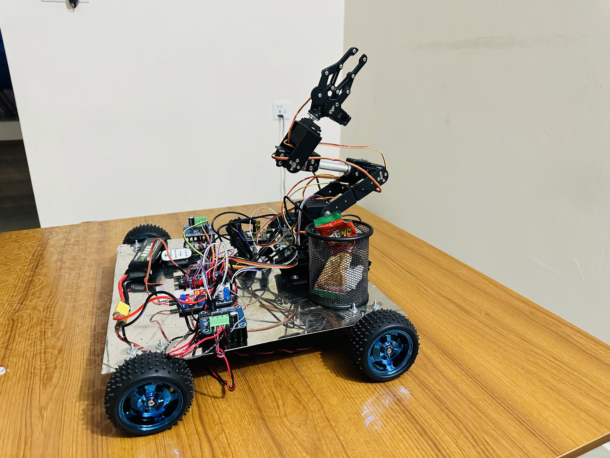

**It working, 11 January 2024:**

| | | |
|---|---|---|
| <a href="docs/media/envirobot-2024-01-11-trash-collecting.mp4">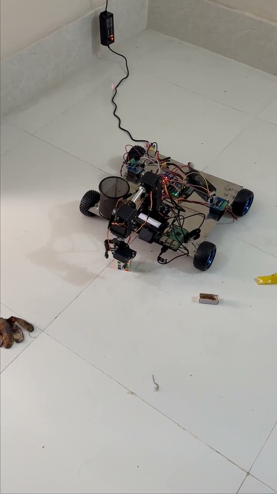</a><br>The arm reaches down, grips a small cube off the floor and lifts it toward the bin ([video](docs/media/envirobot-2024-01-11-trash-collecting.mp4), 45 s) | <a href="docs/media/envirobot-2024-01-11-arm-and-motor-test.mp4">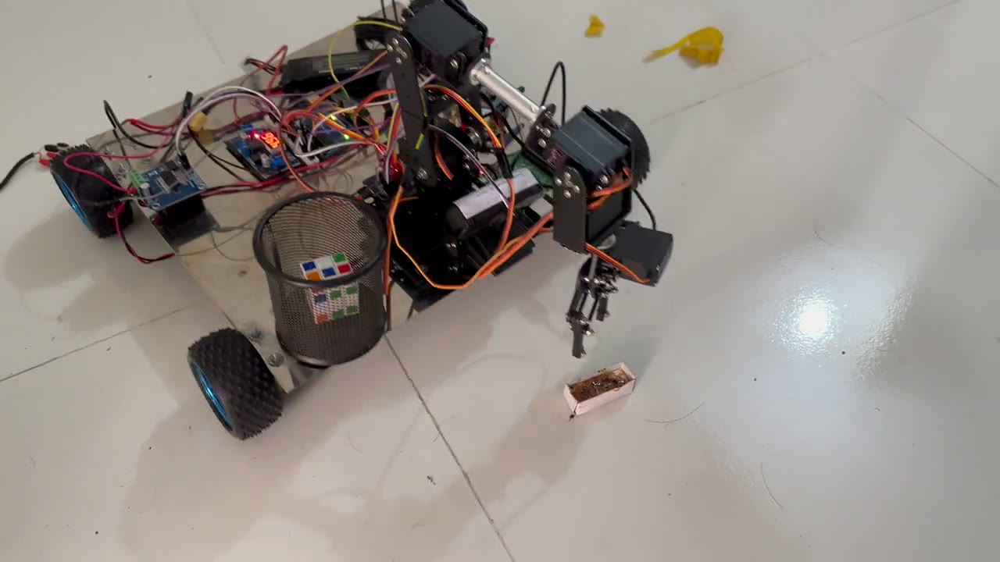</a><br>An arm test on the floor: the arm reaches down to a small box ([video](docs/media/envirobot-2024-01-11-arm-and-motor-test.mp4), 30 s) | <a href="docs/media/envirobot-2024-01-11-yolo-detection-test.mp4">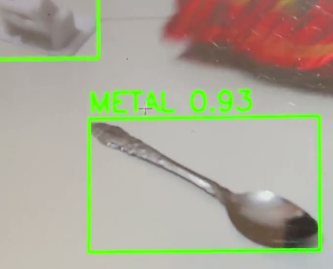</a><br>The YOLOv8 model labelling plastic, metal and trash as they come into view, run on a laptop ([video](docs/media/envirobot-2024-01-11-yolo-detection-test.mp4), 22 s) |

In both arm videos the rover is still on a power cable.
[A close-up of the finished robot](docs/media/envirobot-2024-01-11-robot-close-up.mp4)
(20 s) shows the arm, the bin, the battery, the Arduino and the motor
drivers.

## Technical report

**[EnviroBot: A Mobile Robotic Arm that Detects and Picks Up Waste — Design, YOLOv8 Waste Detection and Prototype](docs/report/envirobot-report.pdf)**
(October 2026, 14 pages): the build, the electronics, the phone control, the
arm model, the waste detector and its evaluation, with 12 diagrams. By Jewel
Nath, Tasmiara Jahan Toma and Tanjina Akter. Its source and the diagrams are
in [docs/report/](docs/report/README.md) and [docs/diagrams/](docs/diagrams/README.md).

## What it does

- **Finds waste.** A camera and a YOLOv8 model trained in Google Colab
  label what they see. The model in the report has three classes, plastic,
  paper and trash, and reached 80% accuracy after 50 epochs of training.
  The live test in the video also labels metal.
- **Picks it up.** The six-servo arm reaches down, grips an object off the
  floor (a small cube in the video) and lifts it toward the bin on the
  rover.
- **Is driven by phone.** An app made in MIT App Inventor, over Bluetooth,
  drives the rover, moves each of the arm's joints, sets its speed, and
  saves moves to play back.

**Not finished when the project ended:** driving a path and collecting
waste on its own (under development in the report), and sorting waste into
separate bins (an aim in the report). The robot has one bin.

## The design

| | | |
|---|---|---|
| 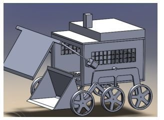<br>An early concept: a six-wheel rover with a scoop. Designed only; the built robot uses an arm | 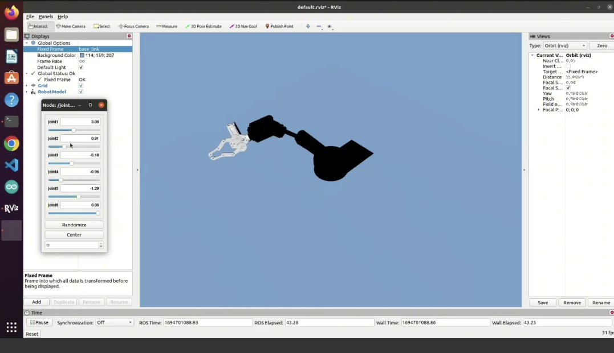<br>**2023-09-14:** the arm's URDF model in RViz, moved joint by joint with sliders | |
| 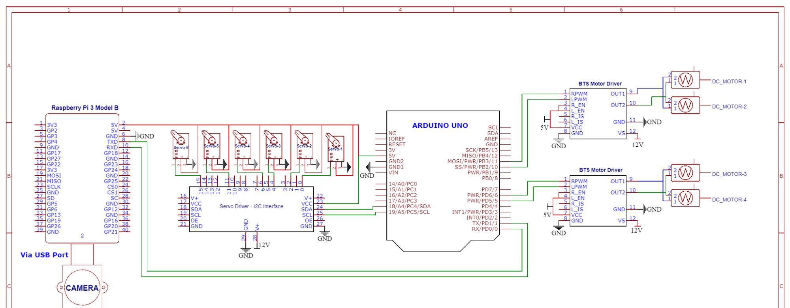<br>The wiring: a Raspberry Pi 3 B, an Arduino Uno, a 16-channel servo driver and two BTS7960 motor drivers | 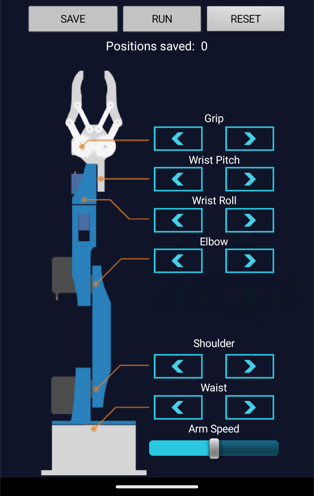<br>The phone app's arm screen: a pair of buttons for each joint, a speed slider, and saved moves | |

## The build

| | | |
|---|---|---|
| 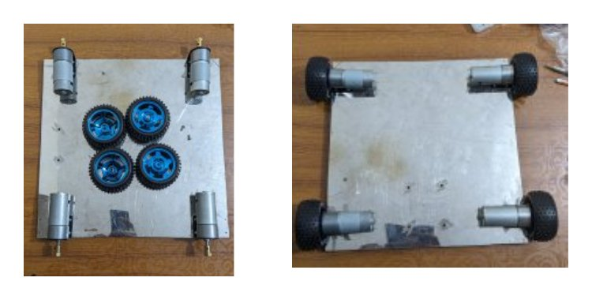<br>The base: four 12 V gear motors bolted under a steel plate, then the wheels | 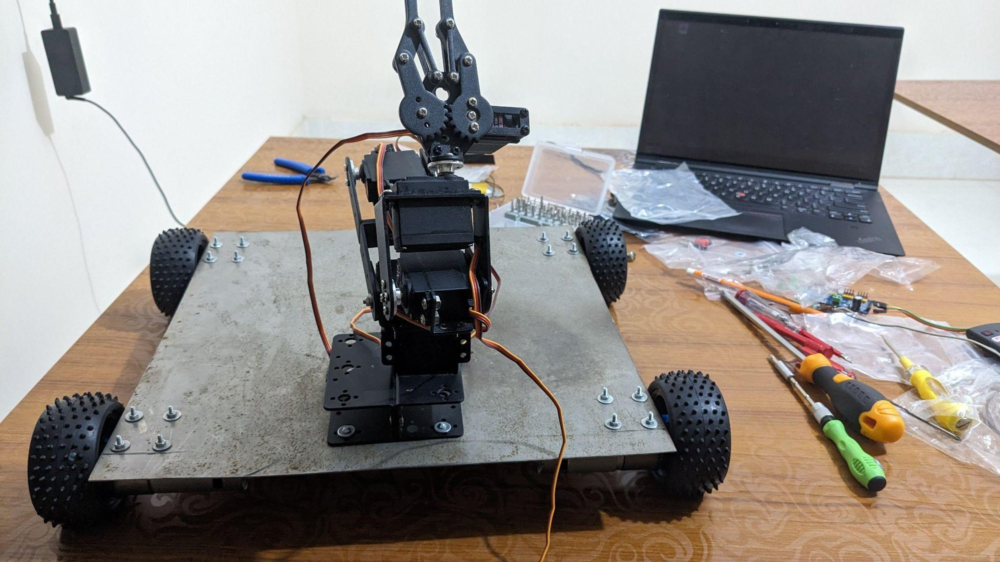<br>The arm fitted on the steel base, before the wiring | 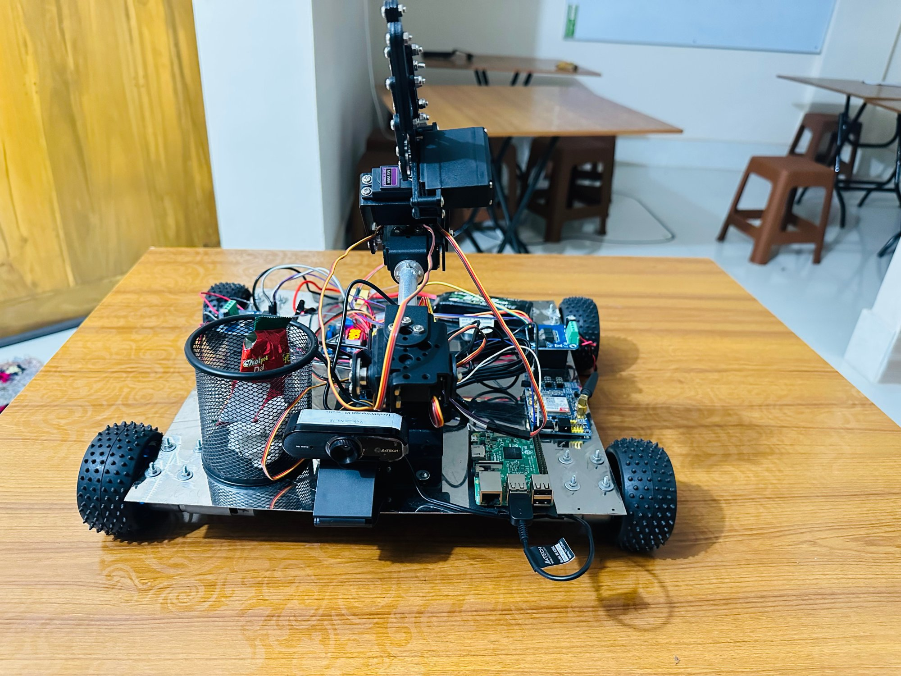<br>Finished, from the front: the camera under the arm, the bin and the Raspberry Pi |

## How it works

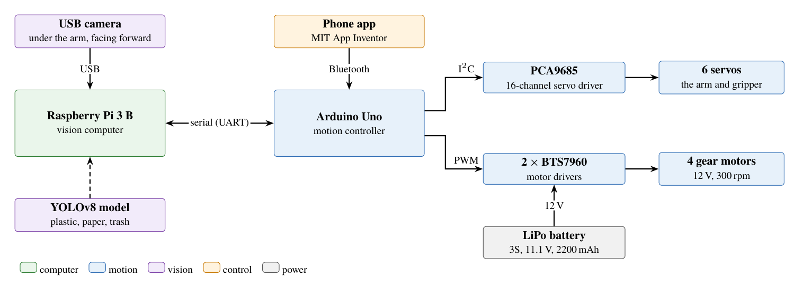

| | |
|---|---|
| 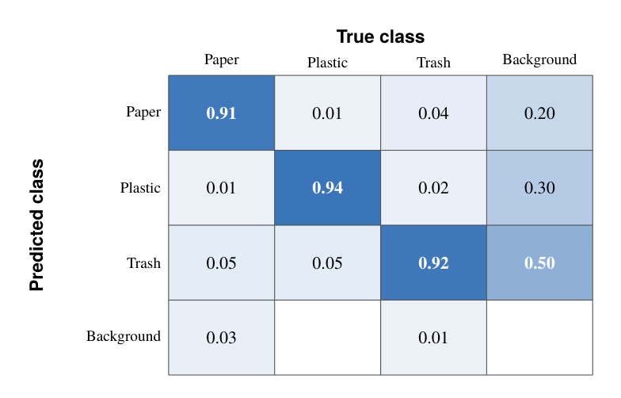<br>**Waste detection:** 91% of paper, 94% of plastic and 92% of trash labelled correctly in the team's evaluation | 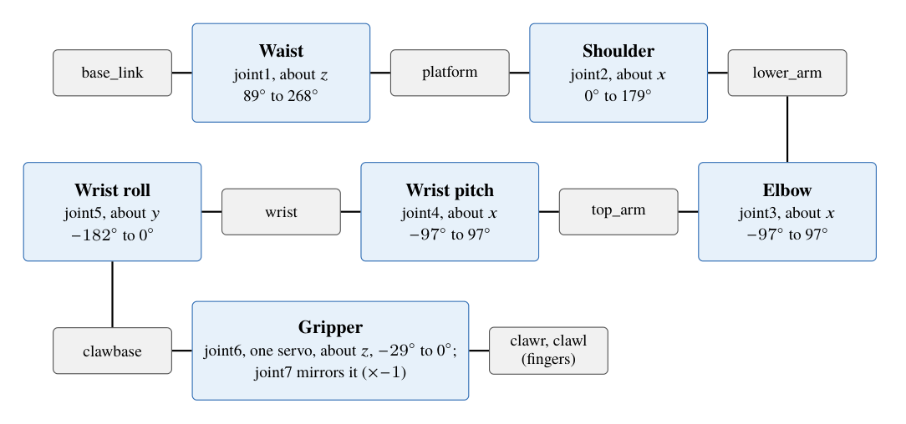<br>**The arm:** six joints from the waist to the gripper, as modelled in URDF |
| 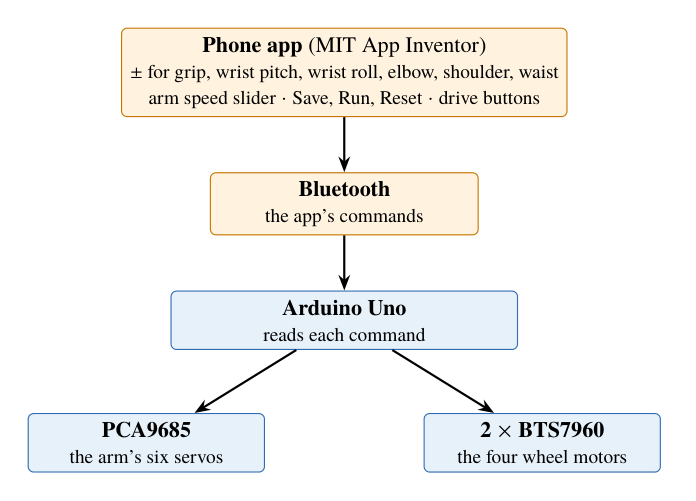<br>**Control:** the phone app drives the rover and each joint over Bluetooth | 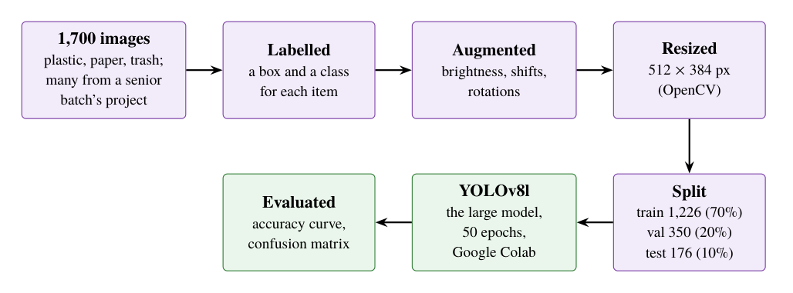<br>**Training:** 1,700 images, three classes, YOLOv8l for 50 epochs |

| | |
|---|---|
| Body | A steel base on four wheels, an aluminium arm with six servos (waist, shoulder, elbow, wrist pitch, wrist roll and gripper), and a mesh bin |
| Motion | Four 12 V gear motors on two BTS7960 drivers, and the arm's servos on a 16-channel servo driver, all run by an Arduino Uno |
| Vision | A USB webcam and a YOLOv8 model, trained in Google Colab on 1,700 images, many of them from an earlier senior batch's project in our department. The report runs it on a Raspberry Pi 3; the video shows it on a laptop |
| Planning | ROS 2 Humble, with the arm's model in URDF, moved in RViz; the team's report plans the arm's motion with MoveIt. This repository holds only the model: see [What is here](#what-is-here) |
| Control | The phone app, made in MIT App Inventor, over Bluetooth |
| Power | A 12 V LiPo battery |

## What is here

This repository holds the robot's model, a ROS 2 package named
[`smart_arm`](src/smart_arm), and the photos and videos on this page. The
detection model, the Arduino code and the phone app are not in it.

| Folder | Holds |
|---|---|
| [`src/smart_arm/description/`](src/smart_arm/description) | The rover base and the arm in URDF/xacro, with their meshes |
| [`src/smart_arm/launch/`](src/smart_arm/launch) | `arm_rviz.launch.py`, which shows the rover base in RViz with a slider for each wheel joint (see [Known problems](#known-problems)) |
| [`src/smart_arm/config/`](src/smart_arm/config) | A ros2_control controller setup for the arm's six joints, not loaded by anything yet |
| [`src/smart_arm/worlds/`](src/smart_arm/worlds) | An empty Gazebo world |
| [`docs/media/`](docs/media) | The photos and videos on this page, the original HEIC photo, and a cut-out of it on white |
| [`docs/report/`](docs/report/README.md) | The technical report: its PDF, its LaTeX source and its figures |
| [`docs/diagrams/`](docs/diagrams/README.md) | Every diagram from the report as its own PDF and PNG |

## The team

EnviroBot was built by Tasmiara Jahan Toma, Tanjina Akter and me at
Comilla University, supervised by Amena Begum, Assistant Professor of ICT. I put this
repository together.

## Run it

The model was made for ROS 2 Humble on Ubuntu 22.04, in 2023–24. From a
workspace with this repository's `src/` in it:

```bash
colcon build
source install/setup.bash
ros2 launch smart_arm arm_rviz.launch.py
```

The launch needs `xacro`, `robot_state_publisher`,
`joint_state_publisher_gui` and `rviz2`, which `package.xml` doesn't list
yet, so install them first.

## Known problems

- **The launch file shows only the rover base.** `robot.urdf.xacro` has
  the arm's include commented out, and the arm's `base_link` has no joint
  to the chassis, so switching it on as it is gives a model with two
  roots.
- The launch file opens `config/view_config.rviz`, which is not in the
  repository, so RViz starts with its default view.
- `joint7`, the second gripper finger, has its lower limit above its upper
  limit.
- `simple_controller.yaml` uses older keys, such as `write_op_modes` and
  `interface_name`, that Humble's joint_trajectory_controller doesn't read,
  and the URDF has no `<ros2_control>` block for it.

## Licence

The code is under the MIT licence: see [LICENSE](LICENSE). The package's
test files come from the ROS 2 package template and keep the Open Source
Robotics Foundation's Apache 2.0 notices.
