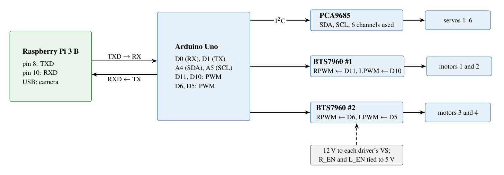
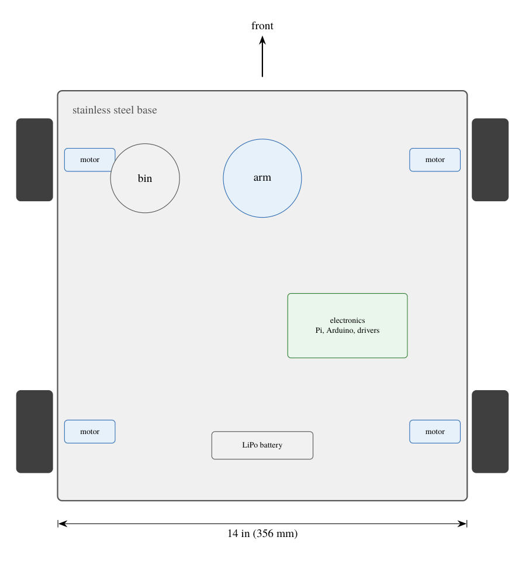
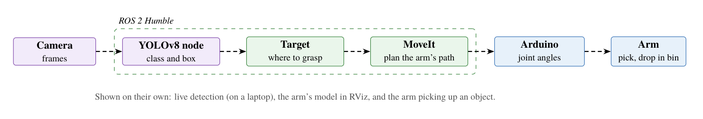
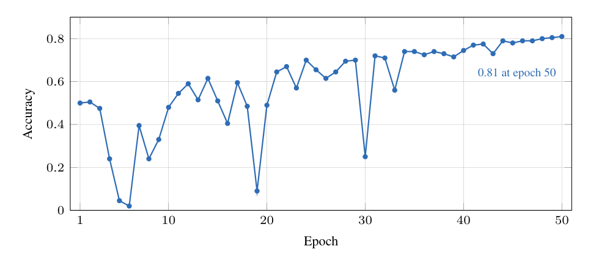
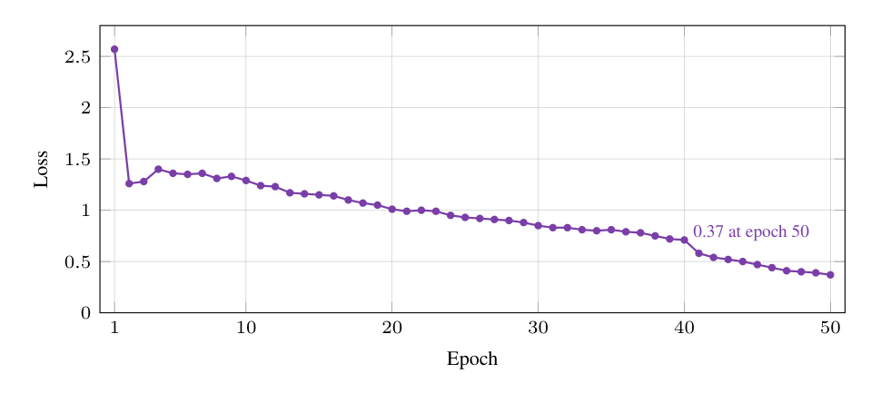
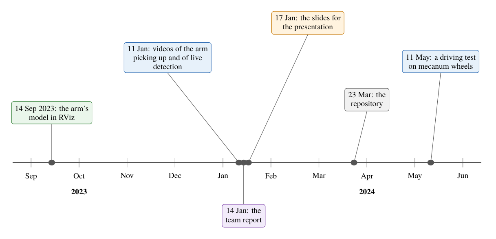
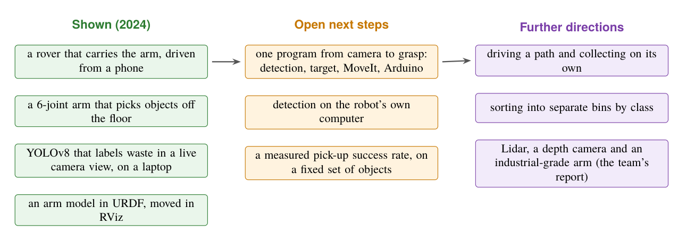

# Diagrams

Every diagram and plot from the [technical report](../report/README.md), each as
its own file:

- **PDF:** vector, sharp at any size. Use it for print, slides and LaTeX.
- **PNG:** 200 dpi on white. Use it for READMEs, posts and web pages.

They share one colour code: green is the computers (the Raspberry Pi), blue
motion (the Arduino, the drivers, the motors and servos), purple vision (the
camera, the dataset and YOLOv8), orange the phone app and Bluetooth, and grey
the base and the power.

| Diagram | What it shows | Files |
|---|---|---|
|  | The whole robot: the Pi, the Arduino, the servo and motor drivers, the camera, the app and the battery | [PDF](envirobot-system-overview.pdf) · [PNG](envirobot-system-overview.png) |
|  | The wiring, pin by pin, from the circuit diagram | [PDF](envirobot-wiring.pdf) · [PNG](envirobot-wiring.png) |
|  | The rover from above: the 14-inch base, the motors, the arm and the bin | [PDF](envirobot-rover-layout.pdf) · [PNG](envirobot-rover-layout.png) |
|  | The arm's joints and links in the URDF model, with their ranges | [PDF](envirobot-arm-chain.pdf) · [PNG](envirobot-arm-chain.png) |
|  | Manual control from the phone app over Bluetooth | [PDF](envirobot-app-control.pdf) · [PNG](envirobot-app-control.png) |
|  | The autonomous pick-up as designed, from camera to arm | [PDF](envirobot-autonomy-pipeline.pdf) · [PNG](envirobot-autonomy-pipeline.png) |
|  | The detector's data and training | [PDF](envirobot-dataset-pipeline.pdf) · [PNG](envirobot-dataset-pipeline.png) |
|  | Training accuracy over 50 epochs | [PDF](envirobot-training-accuracy.pdf) · [PNG](envirobot-training-accuracy.png) |
|  | Training loss over 50 epochs | [PDF](envirobot-training-loss.pdf) · [PNG](envirobot-training-loss.png) |
|  | The detector's confusion matrix | [PDF](envirobot-confusion-matrix.pdf) · [PNG](envirobot-confusion-matrix.png) |
|  | From the arm's first model to the later driving test, Sep 2023 to May 2024 | [PDF](envirobot-timeline.pdf) · [PNG](envirobot-timeline.png) |
|  | What EnviroBot showed in 2024, and the open steps | [PDF](envirobot-roadmap.pdf) · [PNG](envirobot-roadmap.png) |

To rebuild them, run `python make-diagrams.py` in [`../report/`](../report/).
